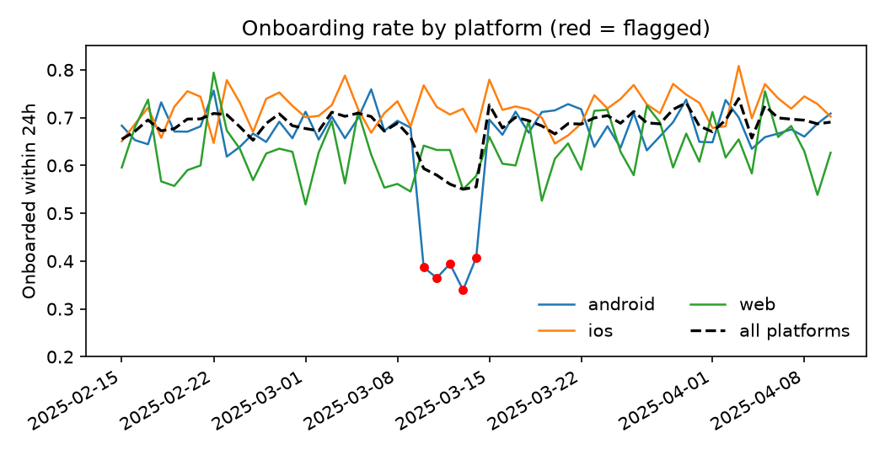

# Product Analytics Casebook: Funnels, Retention, Metric Monitoring, Root Cause

The everyday questions a product analyst answers, worked end to end on one event log:
- where users drop out of the funnel;
- who comes back;
- whether the activation definition means anything;
- what to do when a metric moves overnight: detect it, decide whether it is real, and find where it came from.

The SQL lives in [`sql/`](sql/) and runs on DuckDB.

Author: Junyi (Stanley) Ye · [jyye.org](https://jyye.org) · Full report: [`results/report.md`](results/report.md)

## The data

A simulated subscription productivity app, January to June 2025:
- **Scale:** 75K signups and 2.4M events across iOS, Android and web, from four acquisition channels.
- **Events:** signup, onboarding_complete, session_start, core_action, trial_start, subscription_paid.
- **Users:** each user has a latent engagement level that depends on their channel.

Three incidents are planted so the monitoring can be graded:
- **Android release bug, March 10 to 14:** onboarding completion on Android drops by about 45%;
- **iOS tracking outage, April 22:** 70% of iOS `session_start` events are lost, while behavior is unchanged;
- **Paid social campaign, May 5 to 18:** paid social signups triple, and these users engage less.

## Results

**Funnel** (January–April signups; every step ordered and inside its window):

| Segment | Onboarded (24h) | Activated (3 actions, 7d) | Trial | Paid |
|---|---|---|---|---|
| All | 68.7% | 33.4% | 12.5% | 7.1% |
| Referral | 74.7% | 49.2% | 20.7% | 12.5% |
| Paid social | 62.9% | 19.5% | 6.4% | 3.4% |

The channel gap is widest at activation.

**Retention:** week 4 is 70% for referral signups against 46% for paid social. Week 12 is 52% against 30%.

**Activation bar.** Day-30 retention rises from 34% with no core actions in week one to 71% with three. There is no cliff: from the third action on, each extra action adds less than 8 points. The pattern holds inside every channel, but it is correlation, so the report proposes a test before anyone optimizes for it.

**Monitoring:** days flagged, out of 181.

| Metric | Android bug (5 days) | iOS outage (1 day) | Campaign (14 days) | False alarms |
|---|---|---|---|---|
| Signups | 0 | 0 | 11 | 0 |
| Onboarding rate | 5 | 0 | 0 | 0 |
| DAU | 0 | 1 | 0 | 0 |
| Data check: actions without a session | 0 | 1 | 0 | 0 |
| Onboarding rate, Android only | 5 | 0 | 0 | 0 |



**Diagnosis.** Each change is decomposed into a **mix** effect (a segment's share moved) and a **rate** effect (the segment's own rate moved):
- **Android bug:** onboarding fell 12.2 pts, and 96% of that is Android's own rate. This is a product problem on one platform.
- **April 22:** DAU fell 28%, but only on iOS. iOS users kept doing core actions at the usual rate, and 62% of acting iOS users had no session, which cannot happen in the product. This is a logging failure, not lost users.
- **Campaign:** activation fell 3.1 pts, all of it from mix (−4.0 pts). Paid social's own activation rate did not drop. Nothing broke. The right question is cost per activated user.

## Design decisions

- **Definitions first.** Every metric has a written definition, a window and a baseline in the report. Cohort metrics are keyed to the signup day and are not reported until their window has closed.
- **Ordered funnel.** A step counts only if it follows the previous one inside its window. Counting users who ever did each event overstates conversion.
- **Baselines that fit the metric.** Signups have a weekly cycle, so they are compared with the same weekday over the previous four weeks. The other metrics use the previous seven days, which tracks growth.
- **Robust bands.** The band is the median absolute residual, not the standard deviation, so one bad day does not widen it. Flagged days are left out of later baselines, so an incident does not become the new normal.
- **Data checks next to metrics.** "Acting users with no session" should always be zero. Monitoring it separates a broken pipeline from a real change on day one.
- **Monitor big segments separately.** Per-platform series put a one-platform bug far outside its band, so a smaller bug would still fire even when the overall rate absorbs it.
- **Decompose before explaining.** Mix versus rate tells you whether to talk to engineering or to marketing.

## How it is built

```
sql/
  daily_metrics.sql             one row per day: signups, onboarding, activation, DAU, data check
  segment_daily.sql             the same by platform and channel, for drilldowns
  funnel.sql                    ordered funnel with step windows, by any segment
  retention.sql                 weekly cohort retention, only fully elapsed cells
  activation_threshold.sql      day-30 retention by week-one actions
  data_quality_by_platform.sql  acting users with no session, by platform
prodkit/
  simulate.py   event log with the three planted incidents
  monitor.py    anomaly detector and mix/rate decomposition
run_all.py      runs everything and writes results/report.md and figures
tests/          funnel ordering and windows, retention counting, detector, decomposition
```

## Run it

Requires [uv](https://docs.astral.sh/uv/). The full run takes under a minute.

```bash
uv sync
uv run python run_all.py          # writes results/report.md and results/figures/
uv run --group dev pytest -q      # unit tests
```

## License

MIT. All data is simulated by `prodkit/simulate.py`. No real users or product data are used.
